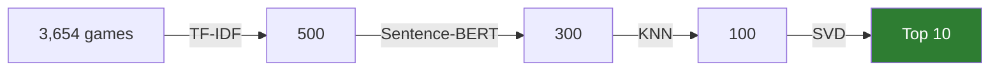
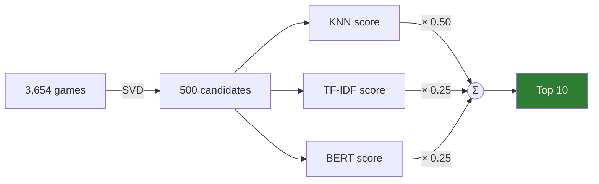

# Hybrid Game Recommendation System

[](https://github.com/Haotian14/HybridGameRecommendationSystem/actions/workflows/ci.yml)


A Steam game recommender that combines **content-based** filtering (TF-IDF, Sentence-BERT) with
**collaborative** filtering (KNN, SVD), and compares two ways of hybridising them:

- **Cascade pipeline**: cheap content models shrink 3,654 games to 300 candidates, then collaborative models make the personalised final cut.
- **Weighted fusion**: SVD proposes 500 candidates, and KNN, TF-IDF and BERT scores are normalised and blended.

Built on ~41M Steam user reviews, filtered to 950K interactions from 8,225 active users.
Originally a group project for COMP9727 Recommender Systems at UNSW Sydney (2025), written as Colab
notebooks, then refactored into a tested,
configurable Python package with a CLI.

```bash
pip install -e .
hgrs demo        # the full system end-to-end on a synthetic dataset, ~2 s, no downloads
```

---

## How it works

### Base models

| Model | Signal | What it computes |
|---|---|---|
| **TF-IDF** | game text (description, tags, genres, categories, developer, publisher) | cosine similarity between the mean TF-IDF vector of a user's games and each candidate |
| **Sentence-BERT** (`all-MiniLM-L6-v2`) | same text, semantic embeddings | `0.7 · embedding similarity + 0.2 · genre overlap + 0.1 · price affinity`, user profile weighted by hours played |
| **KNN** | `is_recommended` (0/1) | neighbourhood collaborative filtering (Surprise `KNNBasic`) |
| **SVD** | 1-5 rating derived from recommendation + hours played | Funk-SVD matrix factorisation (Surprise `SVD`, 100 factors) |

SVD needs explicit ratings, so the implicit signals are mapped to a 1-5 scale:

| recommended? | hours | rating |
|---|---|---|
| yes | ≥ 25 | 5 |
| yes | ≥ 10 | 4 |
| yes | < 10 | 3 |
| no | ≥ 5 | 2 |
| no | < 5 | 1 |

### Strategy 1: cascade pipeline



Each stage re-ranks only the survivors of the previous stage. The content models run first because
they are cheap and handle the cold-start problem: they only need the games' text, not other users.
The collaborative models then pick, from content-relevant games, the ones similar players actually liked.

### Strategy 2: weighted fusion



`final = 0.5 · KNN + 0.5 · (0.5 · TF-IDF + 0.5 · BERT)`, where each score is min-max normalised
per user so that scales like `[0, 1]` and `[1, 5]` can be compared fairly.

Every stage size, model hyper-parameter and fusion weight lives in [`configs/default.yaml`](configs/default.yaml).

---

## Results

Two hand-built test profiles were added to the dataset: a **sports/racing fan** (`22222222`) and a
**Call of Duty / FPS fan** (`11111111`). These are the final top-10 lists produced by the original
notebooks ([`results/`](results)):

<table>
<tr><th>FPS profile: pipeline</th><th>FPS profile: weighted</th></tr>
<tr><td>

1. Valkyria Chronicles 4
2. **Left 4 Dead 2**
3. Dying Light
4. Mount & Blade: Warband
5. Dragon's Dogma: Dark Arisen
6. Borderlands GOTY
7. **Far Cry 3**
8. Gunfire Reborn
9. Deus Ex: Human Revolution
10. Earth Defense Force 5

</td><td>

1. Torchlight II
2. **Insurgency**
3. Broforce
4. **Far Cry 3**
5. Splinter Cell: Chaos Theory
6. Men of War: Assault Squad 2
7. Grim Dawn
8. ASTLIBRA Revision
9. **Left 4 Dead 2**
10. Portal 2

</td></tr>
<tr><th>Sports profile: pipeline</th><th>Sports profile: weighted</th></tr>
<tr><td>

1. Torchlight II
2. Grim Dawn
3. PowerWash Simulator
4. Gunfire Reborn
5. Divinity: Original Sin EE
6. State of Decay 2
7. Tower Unite
8. Far Cry 3
9. **Motorsport Manager**
10. Serious Sam 3: BFE

</td><td>

1. **Wreckfest**
2. Tower Unite
3. F.I.S.T.: Forged In Shadow Torch
4. Torchlight II
5. **Forza Horizon 5**
6. Unturned
7. Gunfire Reborn
8. Creeper World 4
9. Terraria
10. **Motorsport Manager**

</td></tr>
</table>

**What this shows.** The two strategies agree on only 2 (FPS) and 4 (sports) of their 10 picks. The
weighted fusion follows the profile more closely: it finds three racing games for the sports fan, while
the cascade finds one. A likely reason is that the cascade's last stage ranks by SVD alone, and SVD
favours broadly popular, highly rated games (Torchlight II and Grim Dawn are recommended to *both*
users). The fusion keeps the content signal in the final score.

### Offline metrics: an honest note

The original notebooks evaluated each model with a **different protocol**, so their numbers can't be compared:

| Model | Metric (as reported) | Protocol used | Caveat |
|---|---|---|---|
| KNN | P@10 **0.857**, R@10 0.572, RMSE 0.364 | ranks only each user's *own* held-out games | not a recommendation task: most candidates are relevant by construction |
| SVD | P@10 **0.023**, R@10 0.011, RMSE 1.04 | ranks the *full* catalogue for 100 users | the realistic setting |
| TF-IDF | Hit@5 **0.00** | 2 held-out games vs. the full catalogue, 5 users | realistic, but only 5 users |
| TF-IDF | Hit@5 **0.60** | 2 held-out + 8 random games, 5 users | a random ranker scores 0.50 here |

The refactor adds `hgrs evaluate`, which scores **every** model, base or hybrid, under one protocol:
a per-user 80/20 hold-out, full-catalogue ranking, and Precision / Recall / NDCG / HitRate@10. Run it on
the real data to fill in a comparable table (see [Reproducing](#reproducing-on-the-real-data)).

---

## Quick start

```bash
git clone https://github.com/Haotian14/HybridGameRecommendationSystem.git
cd HybridGameRecommendationSystem
python -m venv .venv && source .venv/bin/activate   # Windows: .venv\Scripts\activate
pip install -e ".[dev]"

pytest -q        # 31 tests
hgrs demo        # recommend + evaluate on a synthetic Steam-like dataset
```

`hgrs demo` creates a synthetic dataset with the real schema: 80 users with one or two favourite genres,
and 96 games. It then runs both hybrids and the full evaluation, so the whole system can be tried
without downloading anything. The output below is for the synthetic sports fan; as with the real data,
the weighted fusion stays closer to the user's taste than the cascade:

```
=== pipeline ===
 user_id  rank app_id           name  score  tfidf_score  bert_score  knn_score  svd_score
22222222     1 100010 Sports Game 10  3.976        0.594       0.513      0.886      3.976
22222222     2 100070 Puzzle Game 70  3.954        0.174       0.157      0.794      3.954
22222222     3 100095 Horror Game 95  3.751        0.216       0.146      0.838      3.751

=== weighted ===
 user_id  rank app_id             name  score  knn_score  tfidf_score  bert_score
22222222     1 100002    Sports Game 2  1.000      0.945        0.737       0.632
22222222     2 100010   Sports Game 10  0.838      0.886        0.594       0.513
22222222     3 100026   Sports Game 26  0.754      0.775        0.620       0.561

| model | precision@10 | recall@10 | ndcg@10 | hit_rate@10 | users |
|---|---:|---:|---:|---:|---:|
| tfidf | 0.1320 | 0.5080 | 0.3349 | 0.8400 | 50 |
| bert | 0.1500 | 0.5797 | 0.3962 | 0.8800 | 50 |
| knn | 0.0520 | 0.1773 | 0.1033 | 0.4000 | 50 |
| svd | 0.0600 | 0.2157 | 0.1272 | 0.5200 | 50 |
| pipeline | 0.0700 | 0.2207 | 0.1481 | 0.5600 | 50 |
| weighted | 0.1120 | 0.4150 | 0.2673 | 0.7600 | 50 |
```

### Reproducing on the real data

1. Put the project CSVs in `data/raw/`. The raw files are several GB, so they are not in the repo.

   | File | Contents | Size |
   |---|---|---|
   | `filtered_games.csv` | `user_id, app_id, hours, is_recommended, genre`: users with ≥ 100 and games with ≥ 1,000 interactions | 41 MB |
   | `merged_filtered_games.csv` | the same interactions joined with game metadata (`About the game`, `Tags`, `Categories`, `Price`, …) | 1.9 GB |
   | `user_sport.csv`, `user_call_of_duty.csv` | the two hand-built test profiles | < 50 KB |

   They are derived from two public Kaggle datasets:
   [Game Recommendations on Steam](https://www.kaggle.com/datasets/antonkozyriev/game-recommendations-on-steam)
   (41M user reviews) and the [Steam Games Dataset](https://www.kaggle.com/datasets/fronkongames/steam-games-dataset) (game metadata).

2. Install the BERT extra (pulls in PyTorch), then run:

   ```bash
   pip install -e ".[bert]"
   hgrs recommend --strategy both            # top-10 for the two test profiles -> results/
   hgrs recommend --users 5935019 --top-k 20 # any user id
   hgrs evaluate --out results/metrics.md    # one comparable metrics table for all six models
   ```

   BERT embeddings are cached in `data/processed/` after the first run. To skip PyTorch entirely, set
   `content.encoder: lsa` in the config; this uses a TF-IDF + truncated-SVD encoder instead.

---

## Project structure

```
├── configs/default.yaml        # every path, stage size, hyper-parameter and weight
├── src/hgrs/
│   ├── data.py                 # loading, type normalisation, rating mapping, per-user split
│   ├── models/
│   │   ├── base.py             # Recommender interface: fit / score / recommend
│   │   ├── content.py          # GameCatalog, TF-IDF and Sentence-BERT recommenders
│   │   └── cf.py               # KNN and SVD (Surprise), vectorised SVD scoring
│   ├── hybrid.py               # CascadeHybrid and WeightedHybrid (+ per-stage score breakdown)
│   ├── evaluation.py           # Precision / Recall / NDCG / HitRate@k
│   ├── synthetic.py            # synthetic dataset for the demo and tests
│   └── cli.py                  # `hgrs recommend | evaluate | demo`
├── tests/                      # 31 pytest tests on the synthetic data
├── notebooks/original/         # the original Colab notebooks, unchanged, for reference
└── results/                    # top-10 lists from the original run
```

Every model implements the same small interface, so the hybrids are just compositions of models:

```python
models = build_models(cfg, GameCatalog(games))
fit_base_models(models, interactions)

models["pipeline"].explain("11111111")   # final top-10 plus every stage's score, for transparency
models["weighted"].recommend("11111111", k=10)
```

---

## What the refactor changed

The original work was six Colab notebooks that passed results to each other through CSV files on Google
Drive. Turning them into a package also surfaced several problems:

| Issue in the notebooks | Effect | Now |
|---|---|---|
| KNN `sim_options` (item-based cosine) was defined but **never passed** to `KNNBasic` | all KNN results actually came from Surprise's default: user-based MSD | similarity is set explicitly in the config; the default reproduces what was really run |
| TF-IDF built a combined text field but **vectorised only the description** | tags and genres were ignored by TF-IDF | `content.tfidf_text: combined` (or `about` for the original behaviour) |
| Weighted fusion added raw scores on different scales, with content weights 0.5 / 0.45 / 0.15 / 0.15 (summing to 1.25) | the fusion did not match the documented 50/50 formula | per-user min-max normalisation; weights in the config match the formula |
| The weighted notebook scored one candidate file but fused a different one | results depended on which cells were re-run | candidates flow in memory from one stage to the next |
| Hard-coded `/content/drive/My Drive/...` paths, and `pip install` inside notebooks | could only run in one person's Colab | relative paths in one YAML config, plus `pyproject.toml` |
| The same profile and feature code copy-pasted in four notebooks | changes drifted between copies | one `GameCatalog`, one implementation per model |
| `GridSearchCV` over a single parameter value | three extra fits with nothing searched | SVD is fitted directly |
| Python loop of 3,654 `predict` calls per user for SVD | slow full-catalogue ranking | vectorised `μ + b_u + b_i + q_i·p_u`, tested to match Surprise exactly |
| A different evaluation protocol for each model | numbers not comparable | one protocol for all six models (`hgrs evaluate`) |

## Acknowledgements

Group project for COMP9727 Recommender Systems, UNSW Sydney (2025).

## Future work

- Learn the fusion weights per user, or with a learning-to-rank model, instead of fixing them by hand.
- Add diversity and novelty to the final ranking, to counter SVD's popularity bias seen above.
- Replace KNN and SVD with a neural collaborative model (e.g. LightGCN), and evaluate against a popularity baseline.
