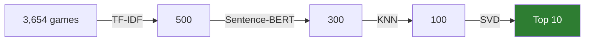
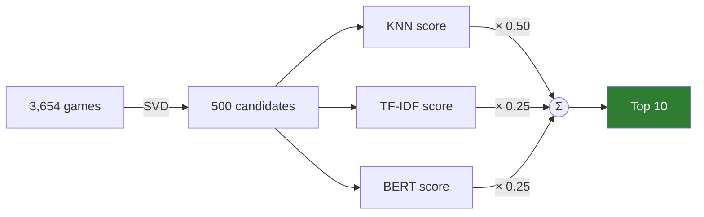

# Hybrid Game Recommendation System

[](https://github.com/Haotian14/HybridGameRecommendationSystem/actions/workflows/ci.yml)


A Steam game recommender that combines **content-based** filtering (TF-IDF, Sentence-BERT) with
**collaborative** filtering (KNN, SVD), and compares three ways of hybridising them:

- **Cascade pipeline**: cheap content models shrink 3,654 games to 300 candidates, then collaborative models make the personalised final cut.
- **Weighted fusion**: SVD proposes 500 candidates, and KNN, TF-IDF and BERT scores are normalised and blended.
- **Adaptive hybrid**: trusts collaborative filtering more as it learns more about a user, so even a brand-new user who has picked just one game gets useful recommendations.

Every model, from a popularity baseline to the hybrids, is evaluated under **one protocol**: for
accuracy, and also for *what kind* of games it recommends (coverage, diversity, novelty, popularity
bias). A cold-start experiment measures how each model copes with users it has never seen.

Built on ~41M Steam user reviews, filtered to 950K interactions from 8,225 active users.
Originally a group project for COMP9727 Recommender Systems at UNSW Sydney (2025), written as Colab
notebooks, then refactored into a tested, configurable Python package with a CLI.

**What the real data says** ([details](#results)):

- A plain **popularity chart is as accurate as any model**, so accuracy alone is a weak target.
  TF-IDF matches it while recommending 13× more of the catalogue.
- The **hybrids double the accuracy** of their collaborative parts (NDCG +0.020 ± 0.006 over SVD).
- **Collaborative filtering is popularity-biased**, and the hybrids inherit it: a sports fan gets
  0/10 sports games from SVD, against 9/10 from the content models.
- A **new user** who names three racing games gets ten driving games back, from a model that never
  saw them in training.

```bash
pip install -e .
hgrs demo        # the full system end-to-end on a synthetic dataset, ~2 s, no downloads
```

---

## How it works

### Base models

| Model | Signal | What it computes |
|---|---|---|
| **TF-IDF** | game text (description, tags, genres, categories, developer, publisher) | cosine similarity between the mean TF-IDF vector of a user's games and each candidate |
| **Sentence-BERT** (`all-MiniLM-L6-v2`) | same text, semantic embeddings | `0.7 · embedding cosine + 0.2 · genre cosine + 0.1 · price affinity`, user profile weighted by hours played |
| **KNN** | `is_recommended` (0/1) | neighbourhood collaborative filtering (Surprise `KNNBasic`) |
| **SVD** | 1-5 rating derived from recommendation + hours played | Funk-SVD matrix factorisation (Surprise `SVD`, 100 factors) |

SVD needs explicit ratings, so the implicit signals are mapped to a 1-5 scale:

| recommended? | hours | rating |
|---|---|---|
| yes | ≥ 25 | 5 |
| yes | ≥ 10 | 4 |
| yes | < 10 | 3 |
| no | ≥ 5 | 2 |
| no | < 5 | 1 |

### Strategy 1: cascade pipeline



Each stage re-ranks only the survivors of the previous stage. The content models run first because
they are cheap and handle the cold-start problem: they only need the games' text, not other users.
The collaborative models then pick, from content-relevant games, the ones similar players actually liked.

### Strategy 2: weighted fusion



`final = 0.5 · KNN + 0.5 · (0.5 · TF-IDF + 0.5 · BERT)`, where each score is min-max normalised
per user so that scales like `[0, 1]` and `[1, 5]` can be compared fairly.

### Strategy 3: adaptive hybrid (cold start)

The first two strategies need the user to be in the training data. A new visitor who says *"I like
these three games"* would get nothing. The adaptive hybrid blends content and collaborative scores
by how much is known about the user:

```
cf_weight = n / (n + 10)        n = games the user has played
score     = (1 − cf_weight) · content  +  cf_weight · SVD
```

| games known | 1 | 3 | 10 | 30 | 100 |
|---|---|---|---|---|---|
| weight on SVD | 0.09 | 0.23 | 0.50 | 0.75 | 0.91 |

Content models only need game descriptions, so they work from the first game. For SVD, a user who
was not in training is **folded in**: with the learned game factors held fixed, the user's bias and
latent vector are fitted to their few games by ridge regression,

```
min  ‖X·w − y‖² + λ‖w‖²      X = [q_i, 1],   y = r_ui − μ − b_i,   w = [p_u, b_u]
```

so the collaborative signal joins in gradually instead of being unavailable until retraining.

```bash
hgrs recommend --likes 1551360 228380 415200    # Forza Horizon 5, Wreckfest, Motorsport Manager
```

Every stage size, model hyper-parameter and fusion weight lives in [`configs/default.yaml`](configs/default.yaml).

---

## Results

All numbers below are on the real data (950K interactions, 8,227 users, 3,654 games), produced by
`hgrs evaluate` and `hgrs cold-start`. Raw tables are in [`results/`](results).

### How everything is evaluated

Every model, from two baselines to the three hybrids, goes through the same two experiments. The
baselines are **popularity** (the most-recommended games, the same for everyone) and **random**.

- **Warm users** (`hgrs evaluate`). 20% of each user's games are held out, and each model ranks the
  *full* catalogue for 200 sampled users.
- **New users** (`hgrs cold-start`). 200 users are removed from training entirely. Each is then
  revealed to the models with n = 1, 3, 5, 10 or 20 known games, and Recall@10 is measured on the
  games they liked among the rest.

Accuracy alone rewards recommending blockbusters, so the warm-user table also describes *what* each
model recommends:

| Metric | Question it answers |
|---|---|
| Precision / NDCG@10 | did it find the games the user went on to like? |
| Coverage | what share of the catalogue does it ever recommend? |
| Diversity | how different are the genres within one top-10 list? (1 − mean pairwise genre cosine) |
| Popularity percentile | how popular are the picks? (1.0 = only the most played games) |

### Warm users

| model | precision@10 | NDCG@10 (± s.e.) | coverage | diversity | popularity pct. |
|---|---:|---:|---:|---:|---:|
| popularity | **0.053** | **0.059** ± 0.007 | 0.7% | 0.41 | 0.998 |
| random | 0.007 | 0.007 ± 0.002 | 42.1% | 0.65 | 0.487 |
| TF-IDF | 0.045 | 0.057 ± 0.007 | 9.0% | 0.42 | 0.671 |
| BERT | 0.028 | 0.027 ± 0.004 | 10.8% | 0.26 | 0.590 |
| KNN | 0.019 | 0.020 ± 0.004 | 4.8% | 0.58 | 0.835 |
| SVD | 0.018 | 0.019 ± 0.004 | 8.5% | 0.60 | 0.838 |
| pipeline | 0.027 | 0.031 ± 0.005 | 7.2% | 0.39 | 0.825 |
| weighted | 0.034 | 0.039 ± 0.006 | 7.0% | 0.36 | 0.825 |
| adaptive | 0.024 | 0.029 ± 0.005 | 8.6% | 0.51 | 0.869 |

Differences below are paired over the same users (mean ± standard error):

1. **A popularity chart is hard to beat, and TF-IDF ties it.** Popularity minus TF-IDF is
   +0.001 ± 0.010 NDCG, so the two are indistinguishable. But popularity shows everyone the same
   handful of blockbusters (0.7% of the catalogue, 99.8th popularity percentile). TF-IDF reaches the
   same accuracy while recommending 13× more of the catalogue, at the 67th percentile.
2. **The hybrids beat their collaborative parts.** Weighted fusion beats SVD and KNN by
   +0.020 ± 0.006 NDCG, about double. The cascade beats SVD by +0.012 ± 0.005. Weighted vs. cascade
   (+0.009 ± 0.006) is not conclusive.
3. **Collaborative filtering has a popularity bias, and the hybrids inherit it.** KNN and SVD
   recommend games at the 84th popularity percentile. For the sports-fan test profile, the content
   models put 6/10 (TF-IDF) and 9/10 (BERT) sports or racing games in the top 10, and SVD puts 0/10:
   SVD's top 500 for this user holds only 14 of the catalogue's 204 sports and racing games. Every
   hybrid gives SVD a decisive say (the cascade's last stage, the weighted candidate pool, and 64%
   of the adaptive score at 18 games), so the sports fan's hybrid lists are mostly action games.
4. **A scoring flaw cost BERT a factor of 4.7.** Its genre term was a raw dot product, so a game's
   score grew with its number of genre tags (up to ~3, against ~0.5 for the text similarity). Its
   top-10 games had 6.9 genre tags on average, against 2.8 in the catalogue. Switching both terms to
   cosine similarity raised precision@10 from 0.006 to 0.028.

Absolute numbers are low because each model ranks all 3,654 games and a user has about 20 liked
games held out. That is typical for full-catalogue evaluation on sparse implicit feedback; the
comparisons between models are what matter.

### New users (cold start)

| model | n = 1 | n = 3 | n = 5 | n = 10 | n = 20 |
|---|---:|---:|---:|---:|---:|
| popularity | **0.024** | **0.024** | **0.024** | **0.024** | **0.025** |
| random | 0.003 | 0.003 | 0.003 | 0.003 | 0.002 |
| TF-IDF | 0.012 | 0.018 | 0.022 | 0.023 | **0.025** |
| BERT | 0.011 | 0.012 | 0.012 | 0.012 | 0.011 |
| SVD (fold-in) | 0.007 | 0.007 | 0.009 | 0.010 | 0.009 |
| adaptive | 0.013 | 0.020 | 0.023 | 0.020 | 0.013 |

<sub>Recall@10 on the games a new user liked among those not revealed, by number of revealed games n.</sub>

- **Popularity is flat**: it ignores the user. **TF-IDF learns fastest**, nearly doubling from 1 to 5
  known games and catching up with popularity at 20.
- **SVD folded in from a few games stays weak.** A handful of ratings barely constrains a 100-factor
  user vector, and SVD is trained to predict ratings, not to rank.
- **The adaptive hybrid** matches TF-IDF while it leans on content (n ≤ 5; the differences are within
  noise), then falls as the weight shifts to SVD (0.50 at 10 games, 0.67 at 20). Blending by history
  length is the right shape, but with this SVD the hand-over at `shrinkage = 10` comes far too early.
  It should be tuned on a validation split.

### A new user, end to end

A visitor who says only that they like *Forza Horizon 5*, *Wreckfest* and *Motorsport Manager*:

```bash
hgrs recommend --likes 1551360 228380 415200
```

| # | game | score | content | SVD (fold-in) |
|---|---|---:|---:|---:|
| 1 | Forza Horizon 4 | 0.904 | 0.931 | 0.813 |
| 2 | GRID | 0.889 | 0.990 | 0.553 |
| 3 | Project CARS 3 | 0.855 | 0.944 | 0.557 |
| 4 | Automobilista | 0.841 | 0.908 | 0.620 |
| 5 | Automobilista 2 | 0.812 | 0.848 | 0.692 |
| 6 | CarX Drift Racing Online | 0.805 | 0.832 | 0.714 |
| 7 | Car Mechanic Simulator 2021 | 0.788 | 0.785 | 0.797 |
| 8 | WRC 7 FIA World Rally Championship | 0.783 | 0.862 | 0.519 |
| 9 | FlatOut: Ultimate Carnage | 0.782 | 0.823 | 0.644 |
| 10 | Car Mechanic Simulator 2018 | 0.781 | 0.798 | 0.723 |

With 3 known games, the collaborative weight is 0.23, so content leads, and every pick is a driving
game. Neither the cascade nor the weighted fusion can serve this user at all.

<details>
<summary><b>Results of the original notebooks</b> (before the refactor)</summary>

The original notebooks' final top-10 lists for the two test profiles
([`results/original_*.csv`](results)):

| FPS: pipeline | FPS: weighted | Sports: pipeline | Sports: weighted |
|---|---|---|---|
| Valkyria Chronicles 4 | Torchlight II | Torchlight II | **Wreckfest** |
| Left 4 Dead 2 | Insurgency | Grim Dawn | Tower Unite |
| Dying Light | Broforce | PowerWash Simulator | F.I.S.T.: Forged In Shadow Torch |
| Mount & Blade: Warband | Far Cry 3 | Gunfire Reborn | Torchlight II |
| Dragon's Dogma: Dark Arisen | Splinter Cell: Chaos Theory | Divinity: Original Sin EE | **Forza Horizon 5** |
| Borderlands GOTY | Men of War: Assault Squad 2 | State of Decay 2 | Unturned |
| Far Cry 3 | Grim Dawn | Tower Unite | Gunfire Reborn |
| Gunfire Reborn | ASTLIBRA Revision | Far Cry 3 | Creeper World 4 |
| Deus Ex: Human Revolution | Left 4 Dead 2 | **Motorsport Manager** | Terraria |
| Earth Defense Force 5 | Portal 2 | Serious Sam 3: BFE | **Motorsport Manager** |

They also evaluated each model with a **different protocol**, so their numbers could not be compared:

| Model | Metric (as reported) | Protocol used | Caveat |
|---|---|---|---|
| KNN | P@10 **0.857** | ranks only each user's *own* held-out games | most candidates are relevant by construction |
| SVD | P@10 **0.023** | ranks the *full* catalogue for 100 users | the realistic setting; consistent with 0.018 above |
| TF-IDF | Hit@5 **0.00** / **0.60** | full catalogue / 2 held-out + 8 random games, 5 users | a random ranker scores 0.50 on the second |

</details>

---

## Quick start

```bash
git clone https://github.com/Haotian14/HybridGameRecommendationSystem.git
cd HybridGameRecommendationSystem
python -m venv .venv && source .venv/bin/activate   # Windows: .venv\Scripts\activate
pip install -e ".[dev]"

pytest -q        # 64 tests, < 1 s
hgrs demo        # everything below on a synthetic Steam-like dataset
```

`hgrs demo` generates a synthetic dataset with the real schema (80 users who each favour one or two
genres, 96 games) and runs all three strategies, a new-user recommendation, and both evaluations,
so the whole system can be tried without downloading anything. An excerpt, for a new visitor who
picked three sports games:

```
=== new user who likes 3 games (collaborative weight 0.23) ===
 rank app_id           name  score  content_score  cf_score
    1 100090 Sports Game 90  0.897          1.000     0.555
    2 100026 Sports Game 26  0.864          0.893     0.767
    3 100042 Sports Game 42  0.856          0.924     0.629
    4 100034 Sports Game 34  0.819          0.768     0.991
    5 100082 Sports Game 82  0.767          0.917     0.265

=== cold start: recall@10 by number of known games ===
| model | recall@10 (n=1) | recall@10 (n=3) | recall@10 (n=5) | recall@10 (n=10) |
|---|---:|---:|---:|---:|
| popularity | 0.144 | 0.162 | 0.169 | 0.168 |
| random | 0.077 | 0.117 | 0.110 | 0.095 |
| tfidf | 0.159 | 0.270 | 0.289 | 0.387 |
| bert | 0.165 | 0.304 | 0.348 | 0.436 |
| svd | 0.133 | 0.129 | 0.149 | 0.188 |
| adaptive | 0.172 | 0.322 | 0.315 | 0.357 |
```

On synthetic data, tastes are generated purely from genres, so the content models are bound to win
here. The demo shows that the system works end to end; it is not evidence about real players.

### Reproducing on the real data

Every number in this README can be reproduced from two public datasets. The data is not in the
repo (2.4 GB of sources), but `hgrs prepare` rebuilds exactly the files the project used and
checks them against the original: row counts and a content fingerprint.
[`data/README.md`](data/README.md) documents the sources, versions, licences and checksums.

| Source | Version | Licence | How to get it |
|---|---|---|---|
| [Game Recommendations on Steam](https://www.kaggle.com/datasets/antonkozyriev/game-recommendations-on-steam) (41M reviews) | Kaggle v28 | CC0 | download `recommendations.csv` (free Kaggle account) to `data/source/` |
| [Steam Games Dataset](https://huggingface.co/datasets/FronkonGames/steam-games-dataset) (game metadata) | Hugging Face rev. `6ba5504` | MIT | downloaded by `hgrs prepare` |

```bash
pip install -e ".[bert]"                     # BERT pulls in PyTorch
hgrs prepare                                 # build data/raw/ from the sources (~20 s)

hgrs recommend                               # all three strategies for the two test profiles
hgrs recommend --users 5935019 --top-k 20    # any user in the data
hgrs recommend --likes 1551360 228380        # a new user, by games they like
hgrs evaluate   --out results/metrics.md     # warm users: accuracy and beyond, all 9 models
hgrs cold-start --out results/cold_start.md  # new users: recall as history grows
```

On a laptop CPU the first run takes about 2 minutes, most of it encoding 3,654 descriptions with
BERT; the embeddings are then cached in `data/processed/`, and `evaluate` takes about 90 s. To skip
PyTorch entirely, set `content.encoder: lsa` in the config; this uses a TF-IDF + truncated-SVD
encoder instead.

---

## Project structure

```
├── configs/default.yaml          # every path, stage size, hyper-parameter and weight
├── data/README.md                # data sources, versions, licences, checksums
├── src/hgrs/
│   ├── config.py                 # typed config: a typo in the YAML fails at load time
│   ├── data.py                   # loading, UserHistory, rating mapping, warm and cold-start splits
│   ├── prepare.py                # rebuild the data from the public sources, verified
│   ├── models/
│   │   ├── base.py               # Recommender / HistoryRecommender interfaces
│   │   ├── catalog.py            # GameCatalog: one row per game, genre matrix, prices
│   │   ├── encoders.py           # Sentence-BERT, or a light TF-IDF+SVD encoder
│   │   ├── content.py            # TF-IDF and BERT recommenders
│   │   ├── collaborative.py      # KNN, and SVD with vectorised scoring and fold-in
│   │   └── baselines.py          # popularity and random
│   ├── hybrid.py                 # cascade, weighted and adaptive hybrids
│   ├── factory.py                # builds every model from the config into one ModelSuite
│   ├── evaluation.py             # accuracy, beyond-accuracy and cold-start metrics
│   ├── synthetic.py              # synthetic dataset for the demo and tests
│   └── cli.py                    # hgrs prepare | recommend | evaluate | cold-start | demo
├── tests/                        # 64 tests on synthetic data; ruff + pytest + demo run in CI
├── notebooks/original/           # the original Colab notebooks, archived as-is
└── results/                      # top-10 lists from the original run
```

There are two interfaces. A `Recommender` scores users it was trained on. A `HistoryRecommender`
only needs a user's play history, so it can also serve someone it has never seen. Hybrids are
compositions of models that share the same fitted parts:

```python
suite = build_models(cfg, GameCatalog(games)).fit(interactions)

suite["pipeline"].explain("11111111")                 # final top-10 plus every stage's score
suite["weighted"].recommend("11111111", k=10)
suite["adaptive"].explain_history(UserHistory.from_liked(["1551360", "228380"]))  # new user
```

---

## What the refactor changed

The original work was six Colab notebooks that passed results to each other through CSV files on Google
Drive. Turning them into a package also surfaced several problems:

| Issue in the notebooks | Effect | Now |
|---|---|---|
| KNN `sim_options` (item-based cosine) was defined but **never passed** to `KNNBasic` | all KNN results actually came from Surprise's default: user-based MSD | similarity is set explicitly in the config; the default reproduces what was really run |
| BERT's genre term was a **raw dot product**, growing with a game's number of genre tags | games tagged with many genres crowded out everything else; precision@10 was 0.006 | cosine similarity for both terms: precision@10 0.028 (4.7×) |
| TF-IDF built a combined text field but **vectorised only the description** | tags and genres were ignored by TF-IDF | `content.tfidf_text: combined` (or `about` for the original behaviour) |
| Weighted fusion added raw scores on different scales, with content weights 0.5 / 0.45 / 0.15 / 0.15 (summing to 1.25) | the fusion did not match the documented 50/50 formula | per-user min-max normalisation; weights in the config match the formula |
| The weighted notebook scored one candidate file but fused a different one | results depended on which cells were re-run | candidates flow in memory from one stage to the next |
| Hard-coded `/content/drive/My Drive/...` paths, and `pip install` inside notebooks | could only run in one person's Colab | relative paths in one YAML config, plus `pyproject.toml` |
| The same profile and feature code copy-pasted in four notebooks | changes drifted between copies | one `GameCatalog`, one implementation per model |
| `GridSearchCV` over a single parameter value | three extra fits with nothing searched | SVD is fitted directly |
| Python loop of 3,654 `predict` calls per user for SVD | slow full-catalogue ranking | vectorised `μ + b_u + b_i + q_i·p_u`, tested to match Surprise exactly |
| A different evaluation protocol for each model, and no baseline | numbers not comparable, and no way to tell whether a model beats "recommend what's popular" | one protocol for all nine models, including popularity and random baselines, plus beyond-accuracy and cold-start experiments |

## Acknowledgements

Group project for COMP9727 Recommender Systems, UNSW Sydney (2025).

## Future work

- Tune the adaptive hybrid's shrinkage (and the fusion weights) on a validation split: on this data
  SVD takes over far too early.
- Counter the popularity bias in the final ranking, e.g. calibrate genre proportions to the user's
  history, or re-rank for diversity with MMR.
- Train a ranking objective (BPR, implicit ALS or LightGCN) instead of SVD's rating regression, and
  compare under the same protocol.
